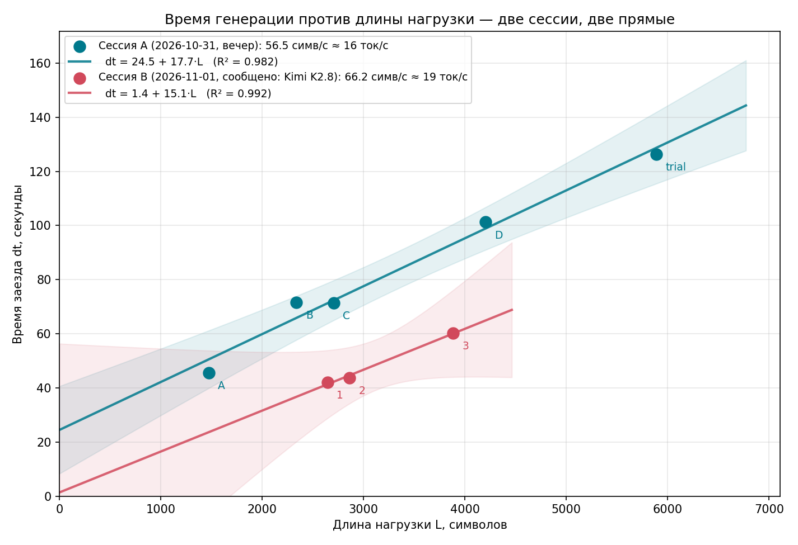
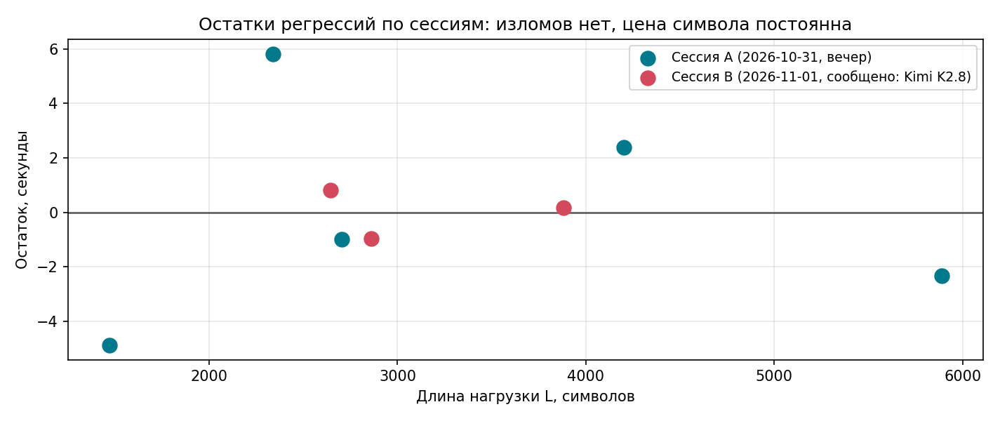

# LLM Speed Metrology / Метрология скорости генерации LLM

> **EN:** Personal measurements of an LLM agent's text generation speed, taken
> from *inside* the conversation — the model measures itself using nothing but
> system clocks and file-writing tools. Method: linear regression over payloads
> of different lengths (overhead hides in the intercept, speed lives in the
> slope). Two sessions so far:
> **Session A (2026-10-31): 56.5 ± 4.4 chars/s ≈ 16 tok/s** ·
> **Session B (2026-11-01, reported Kimi K2.8): 66.2 ± 6.0 chars/s ≈ 19 tok/s**.
> Full write-up below is in Russian.

---

## TL;DR

| Величина | Сессия A (2026-10-31, вечер) | Сессия B (2026-11-01, ночь, сообщено: Kimi K2.8) |
|---|---|---|
| **Скорость генерации** | **56,5 ± 4,4 симв/с** | **66,2 ± 6,0 симв/с** |
| В токенах (3–4 симв/токен) | **≈ 16 ток/с (14–19)** | **≈ 19 ток/с (16–22)** |
| Цена символа (наклон) | 17,70 ± 1,38 мс/симв | 15,12 ± 1,36 мс/симв |
| Накладные расходы на ход | ~24,5 с | ~1,4 с |
| Качество линейной модели | R² = 0,982 (5 точек) | R² = 0,992 (3 точки) |

Сессия B быстрее на **+17 %** — в пределах обычного разброса загрузки кластера;
ошибки наклонов перекрываются, статистически значимого различия пока нет.



## Зачем

Языковая модель не имеет доступа к собственной телеметрии: она не видит, с какой
скоростью стримятся её токены. Любая цифра «из головы» была бы конфабуляцией.
Но у агента есть часы операционной системы и файловая система — этого достаточно
для честного эксперимента: модель измеряет сама себя, записывая протокол по ходу.
Этот репозиторий — журнал таких измерений; каждая новая сессия добавляет точку
на общий график.

## Методика

### Опыт 1 (сессия A): вычитание холостого заезда

1. Два замера `date +%s.%N` подряд, без генерации текста между ними → оценка
   накладных расходов (сеть + диспетчеризация + «размышления» агента): **17,28 с**.
2. Замер → генерация текста-нагрузки (5 888 символов русской прозы через
   инструмент записи файла) → замер: **126,37 с**.
3. Чистое время = 126,37 − 17,28 = 109,09 с → **54,0 симв/с**.

Слабость метода: накладные расходы сами шумные, поэтому вычитание двух шумных
величин даёт ошибку больше каждой из них.

### Опыт 2 (сессия A): линейная регрессия — основной метод

Классический приём метрологии — не измерять добавку напрямую, а построить опыт
так, чтобы она вошла константой:

```
dt = a + b · L
```

где `L` — длина нагрузки в символах, `a` — постоянные накладные расходы
(уходят в свободный член), `b` — искомая цена символа (наклон).

Прогнаны 4 нагрузки разной длины (1 472 / 2 338 / 2 704 / 4 202 символа),
плюс точка опыта 1 как пятая. Тексты нагрузок — связная русская проза одного
стиля (см. `payloads/`), чтобы коэффициент символов на токен был одинаковым
для всех точек.

### Опыт 3 (сессия B): повторное измерение в отдельном заходе

Та же схема регрессии, выполненная другим экземпляром агента на следующую ночь
(в той сессии сообщено: модель Kimi K2.8). Три нагрузки с нарастающей длиной
(2 644 / 2 860 / 3 880 символов, 395–612 слов). Unix-метки в той сессии не
сохранились — в журнал переданы длины и полные времёна заездов; тексты нагрузок
не передавались, поэтому в `payloads/` их нет. Числа из отчёта той сессии
(15,1 мс/симв, 1,4 с, R² = 0,992) воспроизводятся нашим `analyze.py` из
журнальных данных с точностью до округления — отчёт корректен.

## Результаты

### Сессия A (2026-10-31, вечер)

| Точка | Символов | Время, с | Остаток, с |
|---|---|---|---|
| A (опыт 2) | 1 472 | 45,65 | −4,9 |
| B (опыт 2) | 2 338 | 71,68 | +5,8 |
| C (опыт 2) | 2 704 | 71,36 | −1,0 |
| D (опыт 2) | 4 202 | 101,23 | +2,4 |
| trial (опыт 1) | 5 888 | 126,37 | −2,3 |

- **Наклон: 17,70 ± 1,38 мс/символ → 56,5 ± 4,4 символа/с**
- **Свободный член: 24,5 с** — постоянные накладные расходы одного хода диалога
- **R² = 0,982**, остатки в пределах ±6 с без излома.

### Сессия B (2026-11-01, ночь, сообщено: Kimi K2.8)

| Точка | Символов | Время, с | Остаток, с |
|---|---|---|---|
| 1 («сад, осень») | 2 644 | 42,14 | +0,8 |
| 2 («обсерватория») | 2 860 | 43,63 | −1,0 |
| 3 («вокзал») | 3 880 | 60,19 | +0,2 |

- **Наклон: 15,12 ± 1,36 мс/символ → 66,2 ± 6,0 символа/с**
- **Свободный член: 1,4 с** — накладные расходы «схлопнулись» по сравнению
  с сессией A (24,5 с): та константа была свойством захода (паузы-«размышления»
  агента перед ответом, очередь), а не модели.
- **R² = 0,992**, остатки в пределах ±1 с.
- Осторожно: 3 точки = 1 степень свободы, доверительная полоса широкая
  (видна на графике).



### Перевод в токены

Токенизатор модели изнутри недоступен, поэтому используется эмпирический
диапазон для связного русского текста (кириллица токенизируется расточительнее
латиницы):

| Допущение | Сессия A | Сессия B |
|---|---|---|
| 3,0 симв/токен | 18,8 ± 1,5 ток/с | 22,1 ± 2,0 ток/с |
| 3,5 симв/токен | **16,1 ± 1,3 ток/с** | **18,9 ± 1,7 ток/с** |
| 4,0 симв/токен | 14,1 ± 1,1 ток/с | 16,5 ± 1,5 ток/с |

### Перекрёстная проверка

Внутри сессии A два независимых метода согласованы: опыт 1 дал 54,0 симв/с,
регрессия — 56,5 ± 4,4 симв/с. Между сессиями наклоны различаются на
~2,6 мс/симв при ошибке каждого ~1,4 мс/симв — различие в пределах совместной
неопределённости.

## Выводы

1. **Скорость генерации — ≈ 16–19 ток/с в двух независимых сессиях** (56–66
   симв/с). Для человека это ~600–800 слов в минуту: машина пишет быстрее,
   чем читатель успевает читать.
2. **Накладные расходы агентского цикла изменчивы драматически**: 24,5 с в одной
   сессии и 1,4 с в другой. Это не свойство модели, а свойство захода — паузы
   перед ответом, потоковая отдача клиента, очередь. Для коротких ответов именно
   эта константа может доминировать над временем генерации.
3. **Скорость — свойство вечера, а не модели вообще**: она зависит от загрузки
   кластера, маршрута сети и очереди запросов. Разница +17 % между сессиями —
   в пределах такого разброса.
4. **Линейность подтверждена дважды**: в обеих сессиях R² ≥ 0,98 без излома
   остатков — цена символа постоянна вдоль всего диапазона нагрузок, инференс
   идёт ровно, без «усталости» и «разгона».
5. Метод воспроизводим любым агентом с доступом к системным часам и записи
   файлов — без доступа к телеметрии провайдера.

## Ограничения

- Перевод символ → токен — эвристика (основной источник неопределённости итоговой
  цифры в токенах; сами наклоны измерены с ошибкой ±8–9 %).
- Сессии B: всего 3 точки (1 степень свободы), unix-метки и тексты нагрузок не
  сохранились — данные в журнале со слов отчёта той сессии, переданного
  пользователем; наши вычисления по этим данным воспроизводят их выводы.
- Скорость дрейфует с загрузкой кластера быстрее, чем накапливается статистика;
  удлинять серию бесконечно бессмысленно — дальние точки измеряют уже другой час.
- Измеряется скорость всей цепочки «сервер → сеть → клиент», а не «чистого»
  декодирования.
- Нагрузки — монотонная проза; код, таблицы и списки токенизируются иначе.

## Как повторить

### А. Анализ готовых данных

```bash
pip install numpy matplotlib scipy
python analysis/analyze.py      # числа: наклоны по сессиям, ошибки, R², ток/с
python analysis/make_plots.py   # графики в plots/
```

### Б. Весь эксперимент с нуля (с любым LLM-агентом)

Понадобится агент с инструментами «выполнить команду в shell» и «записать файл».

1. **Холостой заезд (опционально):** попросите агента выполнить `date +%s.%N`
   дважды подряд, без генерации текста между вызовами. Разность — оценка
   накладных расходов (сильно шумная, для справки).
2. **Серия заездов:** для ≥ 4 размеров нагрузки (например 1,5k / 2,5k / 4k / 6k
   символов) повторите цикл:
   - `date +%s.%N` — старт;
   - агент пишет файл со связным текстом нужной длины (важно: текст генерируется
     моделью *между* замерами — именно его время вы измеряете);
   - `date +%s.%N` — финиш.
3. **Подсчёт длины:** реальную длину каждого файла считайте постфактум
   (`len(open(f, encoding='utf-8').read())`), а не «на глаз» — автор текста
   не знает, сколько символов написал.
4. **Регрессия:** сложите точки `(символы, секунды)` в CSV формата
   `data/measurements.csv` и прогоните `analysis/analyze.py`. Наклон прямой —
   цена символа; свободный член — накладные расходы; R² и остатки покажут,
   держится ли линейная модель. Разные заходы оформляйте отдельными
   экспериментами — смешивать сессии в одну прямую некорректно.
5. **В токены:** поделите скорость в символах/с на символов-в-токене для вашего
   языка (русский ≈ 3–4, английский ≈ 4–4,5). Если есть доступ к токенизатору
   модели — используйте его вместо эвристики: это снимет главную систематическую
   ошибку.

Готовый промпт для агента:

> Проведи научный эксперимент: измерь собственную скорость генерации в токенах/с.
> Засекай `date +%s.%N` до и после генерации текстовых файлов известной длины,
> сделай серию из 4–5 размеров, построй линейную регрессию, сообщи наклон,
> ошибку и R².

## Структура репозитория

```
├── data/
│   └── measurements.csv      # журнал всех заездов обеих сессий
├── payloads/                 # тексты-нагрузки сессии A (сессия B тексты не передала)
│   ├── exp1_payload.txt      #   опыт 1: 5 888 символов
│   ├── exp2_payload_a.txt    #   опыт 2: 1 472 символа
│   ├── exp2_payload_b.txt    #   опыт 2: 2 338 символов
│   ├── exp2_payload_c.txt    #   опыт 2: 2 704 символа
│   └── exp2_payload_d.txt    #   опыт 2: 4 202 символа
├── analysis/
│   ├── analyze.py            # регрессии по сессиям и вывод чисел
│   └── make_plots.py         # построение графиков
├── plots/
│   ├── regression.png        # точки обеих сессий + прямые + 95% полосы
│   └── residuals.png         # остатки
└── README.md
```

## Заметка о природе эксперимента

Прибор здесь совмещён с экспериментатором буквально: модель пишет протокол
собственного взвешивания, не имея возможности подсмотреть на шкалу до конца
опыта. Тексты в `payloads/` — это и гири, и побочный артефакт: проза о том,
как измеряют измерителей, написанная специально длинной, чтобы её было чем
взвесить.

## License

MIT © 2026 fedor655
